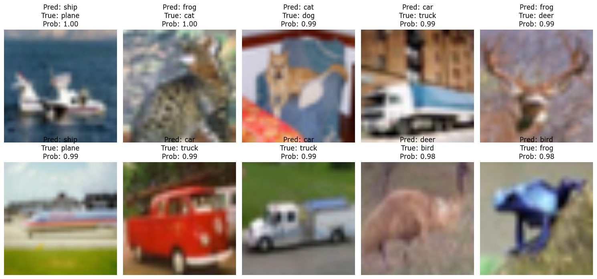

<h1 align="center">CIFAR-10 Image Classification with PyTorch</h1>

<p align="center"><strong>How far can pretrained features take an image classifier in a single epoch?</strong></p>

<p align="center">
  
  
  
  
</p>

This notebook compares two ways to classify images from CIFAR-10. I trained a new classification head on top of an ImageNet-pretrained ResNet18 and built a smaller residual CNN that I trained from scratch. I also looked at the images ResNet18 got wrong with the highest confidence.

## Results

> **78.20% after one epoch** with a pretrained ResNet18 and a new classification head.

| Model | Parameters updated by the optimizer | Epochs | Recorded test accuracy |
| :--- | :--- | ---: | ---: |
| ResNet18 with ImageNet weights | New 10-class classification head | 1 | **78.20%** |
| Custom residual CNN | Entire network | 12 | **71.04%** |

In the recorded run, ResNet18 reached the 70% target in its first epoch. The custom CNN was at 69.03% after 10 epochs and reached 71.04% after two more. ResNet18 finished **7.16 percentage points** ahead in this run.

## A closer look at the mistakes

The notebook shows the **10 highest-confidence misclassifications** from the ResNet18 run. Each image is labeled with the model's prediction, the actual class, and the model's confidence. Two airplanes were labeled as ships and three trucks as cars. The displayed confidence across these ten errors ranged from **0.98 to 1.00**, rounded to two decimals.



## How the models were trained

- **Transfer learning.** I froze the ResNet18 backbone parameters and replaced the final linear layer with a 10-class head. The backbone stayed in training mode during training, so its BatchNorm running statistics could still update.
- **Training from scratch.** I built a CNN with three residual blocks, with skip connections and spatial downsampling, followed by adaptive average pooling and a linear classifier.
- **Shared setup.** Both models used the same CIFAR-10 splits and preprocessing. I resized the images to 224 × 224 and normalized them with ImageNet statistics. Both models used cross-entropy loss, the Adam optimizer with a learning rate of `0.001`, and batches of 64.

The notebook also includes a small convolution exercise. I implemented the 2D sliding-window operation with stride and zero padding, then compared its output with `torch.nn.Conv2d` using identical weights and bias. In the saved check, the maximum absolute difference was approximately `5.72e-6`, and the outputs matched within the tolerance.

## View or run the notebook

Open the `.ipynb` file in this repository to view the saved training logs and images. To run the notebook locally, install the dependencies in a Python environment and launch JupyterLab from the repository folder:

```bash
python -m pip install torch torchvision matplotlib numpy jupyterlab
jupyter lab
```

Open the notebook and run the cells from top to bottom. The first run needs internet access to download CIFAR-10 and the pretrained ResNet18 weights. The notebook uses CUDA when available and otherwise runs on CPU.

## Evaluation note

The original coursework used the CIFAR-10 test split to check the 70% stopping threshold during training. The table reports the saved results from that setup. For a follow-up comparison, I would set aside a validation split for stopping and evaluate each selected model on the test set once at the end.

---

*Developed as part of the Deep Learning course at the Open University of Israel.*
